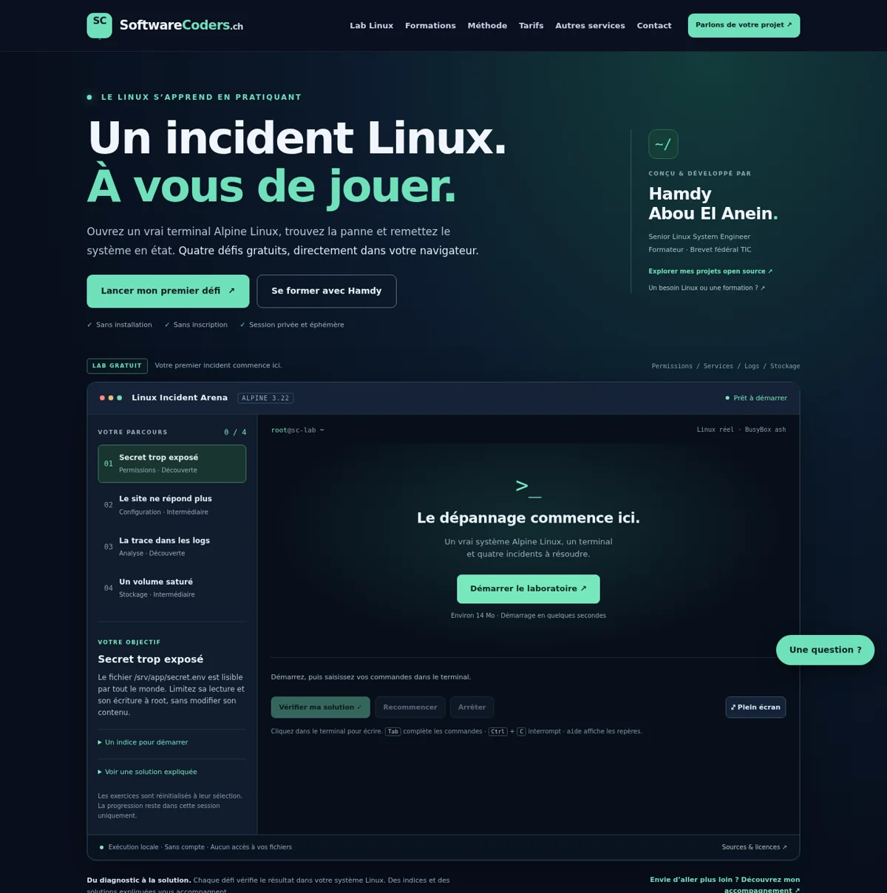

# Software-Coders · Linux Incident Arena

**A real Alpine Linux lab in your browser, built by Hamdy Abou El Anein.**

[Open the website](https://software-coders.ch/) · [Launch the lab](https://software-coders.ch/#laboratoire) · [Sources and licences](arena/SOURCES.md)



A practical introduction to Linux troubleshooting, followed by individual training in Linux, Python, Bash, Go, Rust and cybersecurity.

## What makes the lab real
- Boots an Alpine Linux 3.22.7 x86 guest with the v86 WebAssembly emulator.
- Uses an interactive xterm.js terminal connected to BusyBox ash.
- Four independent incidents: file permissions, a local HTTP service, log analysis and a full tmpfs volume.
- Checks actual Linux state, with both failure and success paths tested.
- Provides progressive hints, explained solutions, a session score and a clean restart.
- Runs locally on the visitor's device: no login, backend compute, host files, network relay or persistent disk.
- Pauses an active guest when its tab is hidden. Desktop keyboards are recommended.

About 14 MB of runtime assets load only after an explicit start. Every asset is below 16 MiB. The static website is hosted on Cloudflare Pages; it does not require the Raspberry Pi.

## Build and preview
The generated runtime is committed, so the usual website build needs only Python:
```sh
python3 scripts/build-pages.py
python3 -m http.server 8080 --directory dist/cloudflare-pages
```
Open http://localhost:8080/.

To rebuild Alpine itself, see [the exact inputs and instructions](arena/SOURCES.md). This uses signed Alpine packages and checksum-locked downloads, in an unprivileged disposable build root.

## Validate
With Node.js, Playwright/Chromium and v86 installed:
```sh
node tests/arena-boot.mjs
node tests/arena-browser.cjs
```
Set `ARENA_V86_MODULE`, `ARENA_PLAYWRIGHT`, `ARENA_BROWSER` or `ARENA_URL` when using existing tool installations or testing a deployed URL. Tests exercise all four repairs, real browser keyboard input, clean restart, pause/resume, stop, hints and responsive layouts.

## Deployment and services
Cloudflare Pages uses `python3 scripts/build-pages.py`, output `dist/cloudflare-pages`. See [deployment notes](CLOUDFLARE-PAGES.md).

The existing contact form uses Formspree, payments use Stripe, and the optional chatbot uses a separate PythonAnywhere backend. They are independent of the Linux guest. No message or payment is submitted by the tests.

## Author and licensing
Developer: **Hamdy Abou El Anein**, Senior Linux System Engineer and IT trainer in Switzerland.
Contact: **info@software-coders.ch** · [GitHub](https://github.com/hamdyaea)

The new teaching code is GPL-3.0-only. Alpine, the Linux kernel, v86, xterm.js and firmware retain their own licences and notices. See [sources, package inventory and licence texts](arena/SOURCES.md). Private settings, credentials, logs and build roots are never included in the public output.
